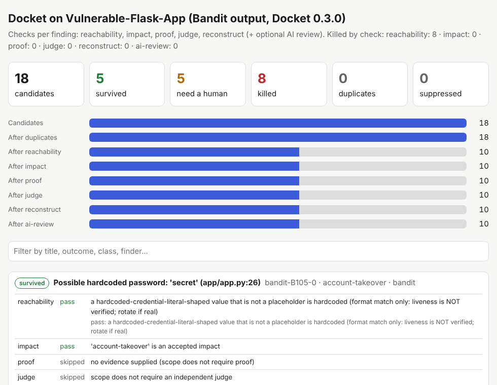
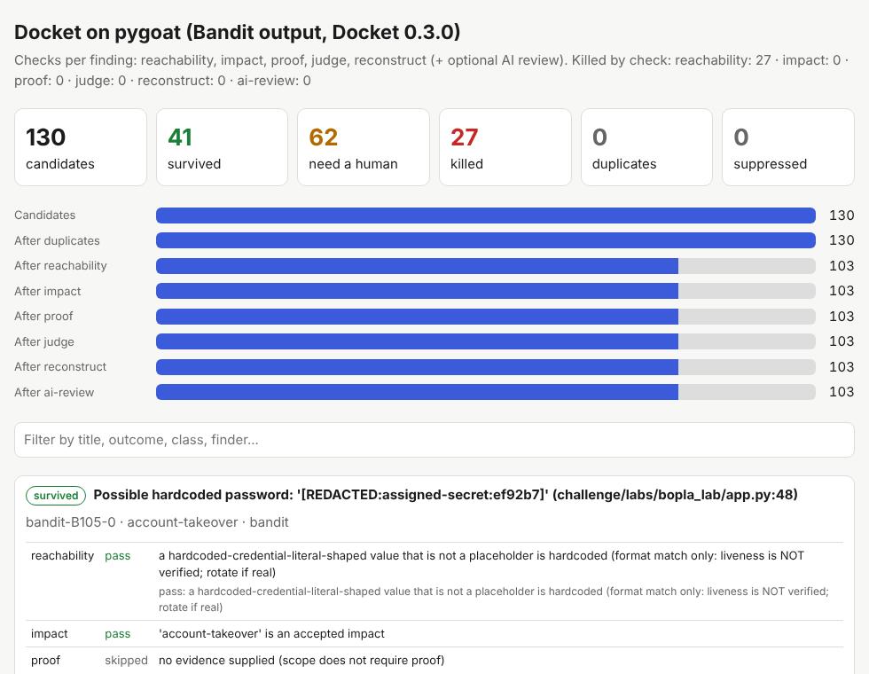
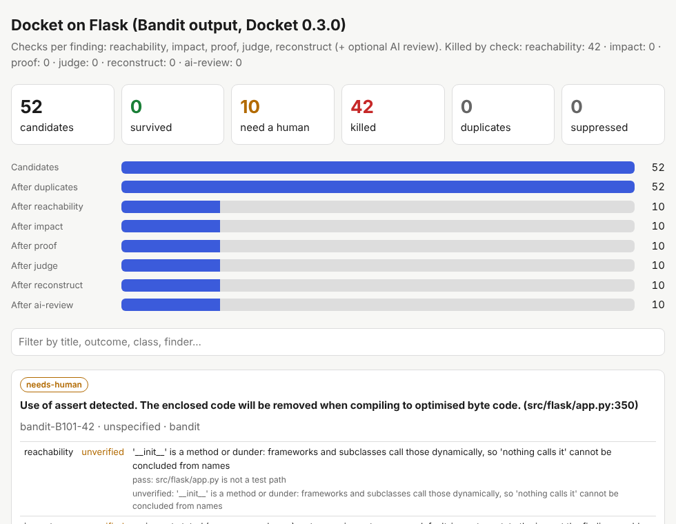

<p align="center">
  <picture>
    <source media="(prefers-color-scheme: dark)" srcset="assets/logo-dark.svg">
    
  </picture>
</p>

<p align="center">
  
  
  
  
</p>

**Docket cuts the noise out of security findings.** Scanners and AI agents produce thousands of claims, and most are wrong
or unprovable. Docket puts each one on trial with the checks a careful triager would run, using code instead of opinions.
You get three piles: **real, with evidence** · **needs a person, with the exact next step** · **dead, with the exact reason**.
Defenders spend their time on what is real.

> **AI may say no. Only evidence can say yes.**
> A model can reject a finding or ask for more proof. It can never make a finding survive.

```text
$ bandit -r src -f json -o scan.json
$ docket try scan.json --target src --pack proof-pack.zip
18 candidates -> 5 survived, 5 need a human, 8 killed
report: docket-report.html          proof pack: proof-pack.zip  (anyone can re-check it: docket replay proof-pack.zip)
```

<p align="center"></p>

## What it does on real work

Docket reads output from the tools you already run: **SARIF (any tool), Semgrep, Bandit, Nuclei, Trivy, Gitleaks**, your
own agents' JSON, or free-text reports (with an AI provider). For each finding it checks:

| Check | Question it answers |
|---|---|
| **reachability** | Can an attacker really get here? Is the code called from a route? Does request data reach the dangerous call (and not through `shlex.quote`, `basename`, parameterized SQL, a safe YAML loader...)? Is it test code? Does the "secret" look real? Is the vulnerable dependency version actually installed and imported? Do your AWS policy / S3 / security-group facts back the claim? |
| **impact** | Is this an impact you would fix or pay for, per *your* scope file? |
| **proof** | Per-class evidence rules for 18 classes (SQLi, IDOR, auth bypass, XSS, SSRF, RCE, SSTI, command injection, path traversal, open redirect, CORS, JWT, mass assignment, rate limit, CSRF, XXE, upload, business logic). A lone 200/500, scanner alert, reflection, or "confidence 0.9" never counts. Docket can **re-test live** on your own hosts and verify callbacks with a canary it controls. |
| **judge** | A blind panel of models (any of Anthropic, OpenAI, Gemini, Ollama/local, any OpenAI-compatible server). They never see the finder's reasoning. Votes from the finder's own model are dropped. |
| **reconstruct** | The cited file, line and quote must exist, and the repro must be short enough to redo by hand. |
| **AI review** *(optional)* | For findings the checks could not settle: an AI explains what would settle it, and can argue against it. It cannot approve. |
| **duplicates, suppressions** | Same root cause seen before; accepted risks recorded **with a reason, an author and an expiry**. |

Everything unknown or malformed ends up `needs-human`, never as a silent pass, and every `needs-human` comes with a
"what to do next" box that names the exact flag or evidence that would settle it.

## Measured on public code

**Click a picture to open the full, searchable HTML report** (hosted on GitHub Pages). All six reports and a summary
page are at [https://1337exe.github.io/docket/reports/](https://1337exe.github.io/docket/reports/).

<p align="center">
  <a href="https://1337exe.github.io/docket/reports/Vulnerable-Flask-App.html"></a>
  <a href="https://1337exe.github.io/docket/reports/pygoat.html"></a>
  <a href="https://1337exe.github.io/docket/reports/flask.html"></a>
</p>
<p align="center"><sub>Vulnerable-Flask-App &nbsp;·&nbsp; pygoat &nbsp;·&nbsp; Flask (a maintained library: almost everything Bandit flagged was test code)</sub></p>

The same files are in [`docs/reports/`](docs/reports/).

We ran Bandit on six public repositories, then ran Docket on Bandit's output (`bash benchmarks/run_public.sh` reproduces it;
Docket 0.3.0, no AI, no live probes, `impact_map` from the file in `benchmarks/`).

| Repository | Bandit results | Survived | Need a human | Killed |
|---|---:|---:|---:|---:|
| [pygoat](https://github.com/adeyosemanputra/pygoat) (deliberately vulnerable Django) · [**open report**](https://1337exe.github.io/docket/reports/pygoat.html) | 130 | 41 | 62 | 27 |
| [Vulnerable-Flask-App](https://github.com/we45/Vulnerable-Flask-App) · [**open report**](https://1337exe.github.io/docket/reports/Vulnerable-Flask-App.html) | 18 | 5 | 5 | 8 |
| [VAmPI](https://github.com/erev0s/VAmPI) · [**open report**](https://1337exe.github.io/docket/reports/VAmPI.html) | 7 | 2 | 3 | 2 |
| [dvpwa](https://github.com/anxolerd/dvpwa) · [**open report**](https://1337exe.github.io/docket/reports/dvpwa.html) | 2 | 0 | 2 | 0 |
| [Flask](https://github.com/pallets/flask) (maintained library) · [**open report**](https://1337exe.github.io/docket/reports/flask.html) | 52 | 0 | 10 | 42 |
| [Requests](https://github.com/psf/requests) · [**open report**](https://1337exe.github.io/docket/reports/requests.html) | 16 | 0 | 16 | 0 |
| **Total** | **225** | **48** | **98** | **79** |

What those numbers mean, honestly:

* **79 results were removed with a stated reason**: 45 were in test/fixture code, 30 were not secrets (placeholders, empty
  values, environment reads), 4 were safe by construction (argv-list subprocess) or dead code. On Flask, 42 of 52
  Bandit results sit in test code (mostly `assert` statements in the tutorial's tests).
* **The survivors in the three vulnerable apps are the bugs those apps are built to contain**: SQL injection in
  `search_customer`, command injection, pickle and YAML deserialization, hardcoded credentials and signing keys.
  Docket traced request data to the sink in each. These were not new discoveries; the apps are intentionally vulnerable.
* **98 needed a human** because Docket could not prove them either way (no vulnerability class from the scanner,
  a parameter whose callers are not traced, projects routed by OpenAPI/connexion, data that arrives through a file).
  That is the intended behaviour; it is also the biggest area to improve.
* **We spot-checked the kills by reading the code, and that found two real mistakes in earlier builds** (a scanner's wrong class guess
  killed a genuine `eval` bug; methods called by a framework were declared "dead code"). Both are fixed and covered by tests.
  We did not measure recall against a labelled ground truth beyond the lab below, so treat these as an honest demonstration, not a benchmark score.
* The synthetic lab does have ground truth: **28 claims across 14 vulnerability classes, 28/28 verdicts correct**, including
  the look-alikes that must die (`docket lab`).

## Install

Python 3.10+, no third-party dependencies, works offline.

```bash
pip install git+https://github.com/1337exe/docket        # or: pipx install git+https://github.com/1337exe/docket
docket doctor                                              # checks your machine and tells you what to fix
docket selftest                                            # under a minute, localhost only: lab, demo, scanner triage, proof pack
```

From source: `git clone https://github.com/1337exe/docket && cd docket && python3 -m venv .venv && . .venv/bin/activate && pip install -e .`
or `bash scripts/quickstart.sh`.

## Use it (pick your path)

| You have | Do this | Guide |
|---|---|---|
| Scanner output | `docket try scan.json --target ./src` | [getting-started](docs/getting-started.md) |
| CI/CD | one job; fail the build only on survivors | [ci-cd](docs/ci-cd.md) |
| An AI agent (Claude Code, Cursor, custom) | `docket mcp`: the agent checks findings before it reports | [mcp](docs/mcp.md) |
| No internet / code that must not leave | everything works offline; local models via Ollama | [offline](docs/offline.md) |
| AI judges, escalation, report extraction | `--judge anthropic:MODEL --escalate openai:MODEL` | [ai-providers](docs/ai-providers.md) |
| Your own checks, other languages | plugin verifiers in any language | [reference](docs/reference.md#plugin-verifiers) |
| A team that needs an audit trail | `--suppressions`, `--audit-log`, `--pack` + `docket replay` | [getting-started](docs/getting-started.md#make-it-yours) |

The 10-minute path:

```bash
docket init . --profile ci          # scope.json, docket.json, suppressions file
$EDITOR scope.json                  # list the impacts you would actually fix
bandit -r src -f json -o scan.json
docket try scan.json --target src --pack proof-pack.zip
```

Try a safe demo first: `docket kit ./docket-kit && cat docket-kit/KIT.md` writes a 30-finding sample case, a
deliberately vulnerable lab app (localhost only), example judges and CI templates.

## Features nobody asked for but a defender needs

* **Proof packs and offline replay.** `--pack` bundles findings, scope, recorded judge/probe/AI answers, the cited source
  and a hash manifest. `docket replay` re-checks the verdicts on another machine and detects tampering.
* **Audited suppressions.** Accepted risk needs a reason and an author; expiry is supported and expired rules are reported.
* **Tamper-evident audit log.** Hash-chained verdict records; `docket audit` finds edits and deletions.
* **Secrets are masked** before anything is sent to an AI and in every report.
* **Prompt-injection resistant.** Findings are fenced as untrusted data; reasoning, severity and confidence are never inputs to a check.
* **Budget, cache, retries** for AI calls; a failing provider turns a vote into "unsure", never a pass.
* **Annotated SARIF.** Killed/duplicate/suppressed scanner results get a SARIF suppression with Docket's reason.
* **Reports** with search, "what to do next" boxes and a pinned-hash CSP (no remote code); a Markdown summary for PRs.
* **Live probes with guard rails**: own hosts only, redirects never followed, request budget, canary with minted nonces.
* **Per-finder scoreboard** (`--ledger`, `docket stats`): which agent or tool wastes your time?

## Why this exists: what we studied and what it became

We studied how AI-generated security reports fail in practice, and built each lesson into Docket. The lab contains a
recreation of each pattern with known ground truth; **we have not run Docket on the original reports**, only on the
public repositories above.

1. **A report that cited a function that does not exist (curl).** A polished HTTP/3 report named an affected function that
   never existed, and a maintainer had to read the source to find out ([write-up](https://dev.to/brandincanfield/the-curl-bug-report-that-cited-a-function-that-doesnt-exist-2jo9));
   curl later [ended its HackerOne bounty](https://bleepingcomputer.com/news/security/curl-ending-bug-bounty-program-after-flood-of-ai-slop-reports/)
   after a flood of such reports. → Docket's *reconstruct* check: the cited file, line and quote must exist; `taint_flow`
   answers "function not defined anywhere". Lab **L13**.
2. **"SQL injection" inferred from odd behaviour.** XBOW's account of an agent flagging SQLi from strange auth behaviour
   ended with "plausibility is not proof" ([XBOW](https://xbow.com/blog/why-llms-hallucinate-vulnerabilities)).
   → Per-class proof: true/false control pairs, repeated timing against a baseline, DB error signatures, callbacks.
   Lab **L07** dies, **L03** survives.
3. **"It looks exploitable" with nothing to run.** Maintainers describe junk reports as untested theories, known issues and
   duplicates ([Help Net Security](https://www.helpnetsecurity.com/2026/05/18/problems-with-ai-assisted-vulnerability-research/)).
   → `require_proof`, `ineligible_patterns`, `known_issues`, fingerprints, `--baseline`. Lab **L12, L14**.
4. **Reachable versus theoretical.** Triage write-ups list helpers no endpoint calls, flags that are off, sanitizers on the
   path ([CodeFundi](https://www.codefundi.app/blog/reachable-vs-theoretical-security-triage/)).
   → `entrypoint_reaches`, `taint_flow`, `flag_enabled`, test-code detection. Demo **F17, F18, F24-F29**.
5. **What counts as valid proof, per class** ([Strobes](https://strobes.co/blog/agentic-pentesting-validation/)):
   another user's data for IDOR, a callback for SSRF, an expression *evaluated* for SSTI. → `proof.py`, and the lab
   tests both sides (**L01/L11, L04/L08, L15-L28**).
6. **A practitioner's filter for AI findings**: reachable state? accepted impact? survives a second independent judge?
   rebuildable in under 10 minutes? Of 14 AI attack paths, 2 survived and 1 was valid. → Docket is that filter as a
   program, and the ledger makes "12 of 14 died" a measurable per-agent rate.

Plus a cloud example: "the web role can escalate via `iam:PassRole`" is evaluated against the role's policy in
`facts.json`: explicit Deny wins, conditions become `needs-human`, a policy that never grants it kills the claim (demo **F05**).

## How it compares

Pieces of this idea exist elsewhere: findings-triage, sift-sast, exploitation-validator, AnyPoC, OpenAnt, BugBounty Hunter
and vuln-triage-mcp each cover part of it, and GitHub's Security Lab Taskflow Agent validates inside its own pipeline.
Docket's bet is the **combination**: a scope contract + per-class proof rules + live probes with a canary +
enforced judge independence + scanner-agnostic importers + an MCP self-check for agents + "AI can reject, never approve" + offline-replayable proof packs.
This is our best reading of what exists as of October 2026, not a guarantee; if you know a closer match, please open an issue.

## Safety and responsible use

* Live probes are off unless `--active`; only hosts in `scope.active_hosts` are contacted; redirects are not followed;
  GET/HEAD/POST only; bodies capped; request budget enforced. **Only test systems you own or are authorised to test.**
* Docket never executes the code it analyses. Paths outside `--target` and symlinks are ignored; verifier, judge and plugin crashes become `unverified`.
* `docket lab` is intentionally vulnerable: localhost only, never expose it.
* A "secret" that passes is a **format** match: Docket does not test whether it is live. Rotate real ones.


See [CONTRIBUTING.md](CONTRIBUTING.md) and [SECURITY.md](SECURITY.md). MIT licensed ([LICENSE](LICENSE)).
Found a verdict you disagree with? Open an issue with the command, the input and the output. Those are the most useful reports.
